# Northline Knowledge Workspace

### A knowledge workspace I built for industrial equipment support and after-sales service

**I built this system so support agents can answer equipment and warranty questions by finding relevant information across product manuals, fault-code workbooks, installation guides, and service policies.** It brings an answer and the retrieved source passages into one workspace so an agent can review the evidence before advising a customer.

The business setting is **industrial automation and manufacturing technology**. Northline supplies industrial IoT gateways that connect factory equipment to monitoring systems. Its service desk handles installation problems, device faults, warranty questions, returns, and spare-parts enquiries. The primary users are technical support and after-sales agents; knowledge administrators maintain the source collection, and Product Engineering reviews uncertain cases.

> **Portfolio case study:** Northline is a fictional company, and its customer memo and source documents are simulated. I built it on an existing FastAPI/Vue RAG codebase, adding document-lifecycle fixes, restart recovery, a retrieval evaluation, and a reproducible local deployment.

[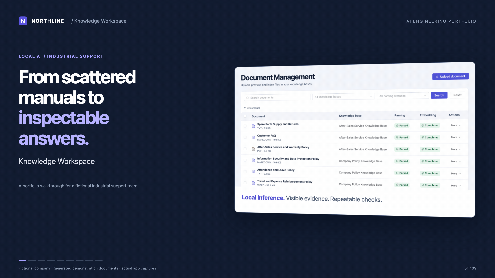](docs/media/northline-demo.mp4)

*30-second looping preview from the recorded demo · 3840 × 2160.* [Full HD GIF](docs/media/northline-demo-1080p.gif) · [Original 4K screenshots](docs/media/northline-screenshots-4k.zip) · [Static preview](docs/media/cover.png)

**[Watch the 2:21 demo](docs/media/northline-demo.mp4)** · [Customer-background memo](Technical%20Support%20and%20Warranty%20Background.docx) · [Recorded results](docs/verification/README.md) · [Run locally](docs/LOCAL_SETUP.md)

## What the workspace does

Each screenshot is an unedited capture from the running application. Click an image to open it at full resolution.

<table>
<tr>
<td width="50%" valign="top">

**1. Manage the knowledge collection**<br>
Upload documents to a knowledge base and track parsing and embedding status for each one. The demo holds 11 documents in five formats across three knowledge bases.

<a href="demo/raw/02-documents.png">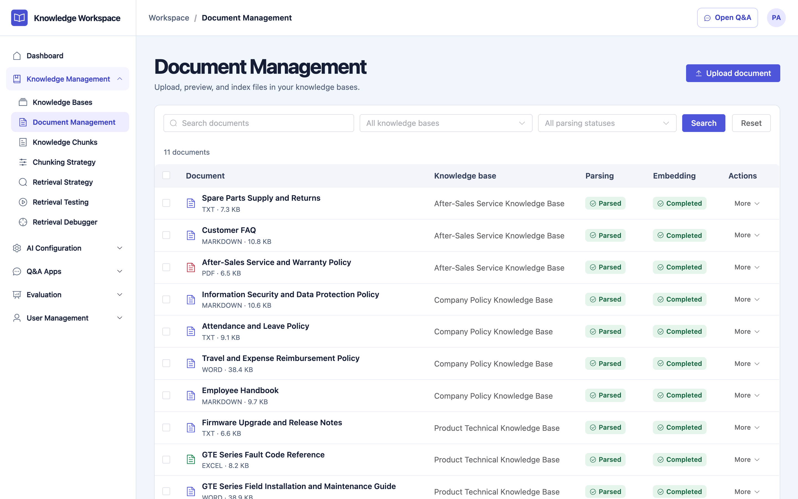</a>

</td>
<td width="50%" valign="top">

**2. Check parsed content before indexing**<br>
Preview the text extracted from a file, including spreadsheet tables, before it is split into chunks and embedded.

<a href="demo/raw/03-parsed-document.png">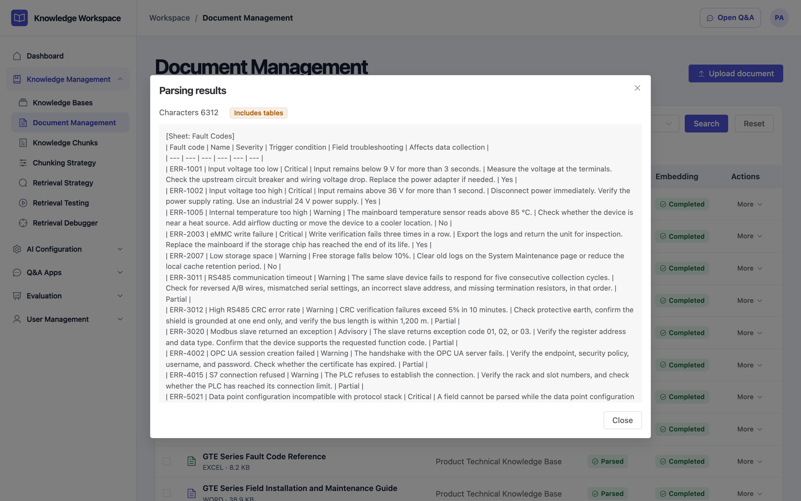</a>

</td>
</tr>
<tr>
<td width="50%" valign="top">

**3. Trace what retrieval found**<br>
Run a query against a knowledge base and see each retrieval stage, its timing, and the ranked passages with their similarity scores.

<a href="demo/raw/04b-retrieval-evidence.png">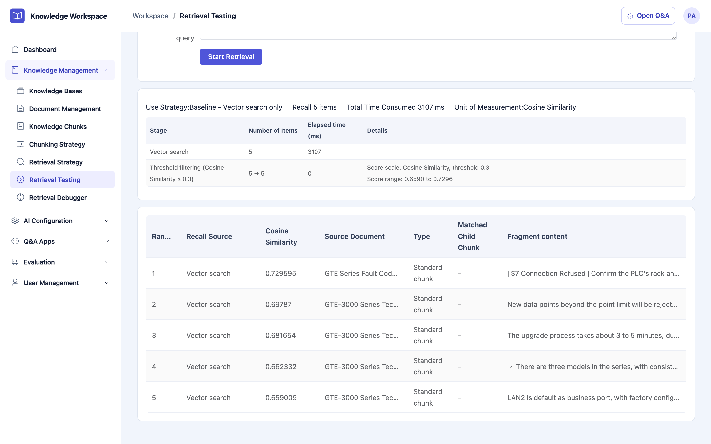</a>

</td>
<td width="50%" valign="top">

**4. Ask a question**<br>
Ask a Q&A app such as the Product Technical Assistant. The answer comes back with the sources it was built from, and earlier conversations stay in the sidebar.

<a href="demo/raw/05-answer.png">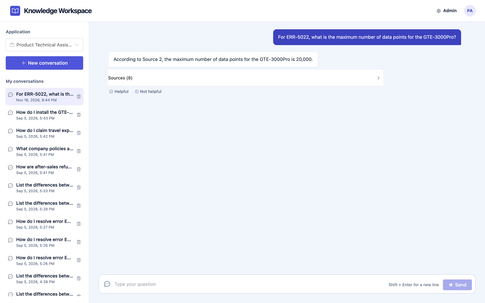</a>

</td>
</tr>
<tr>
<td width="50%" valign="top">

**5. Inspect the evidence**<br>
Expand **Sources** to read each retrieved passage behind an answer, with its chunk number and relevance score.

<a href="demo/raw/06-sources.png">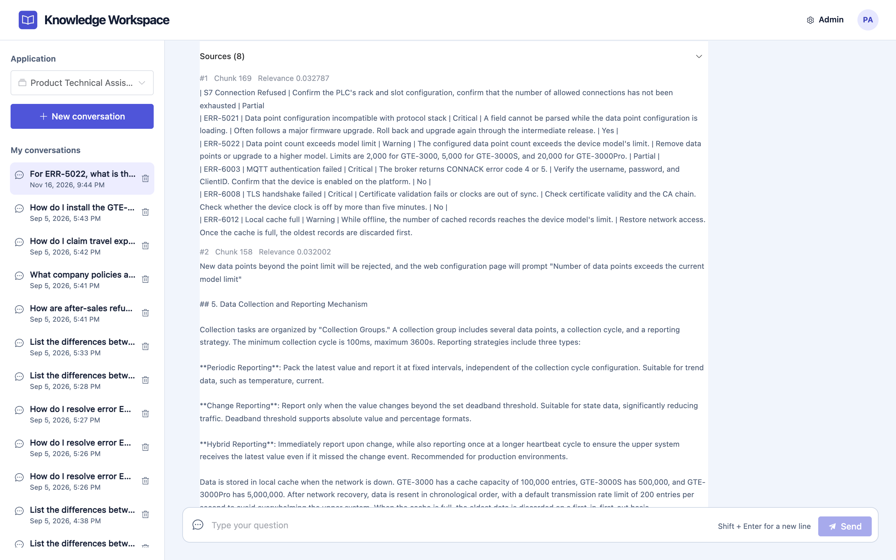</a>

</td>
<td width="50%" valign="top">

**6. See and retry failed processing**<br>
Every processing attempt is recorded. A failed parse stays visible with its reason, and the step can be retried.

<a href="demo/raw/08-recovery.png">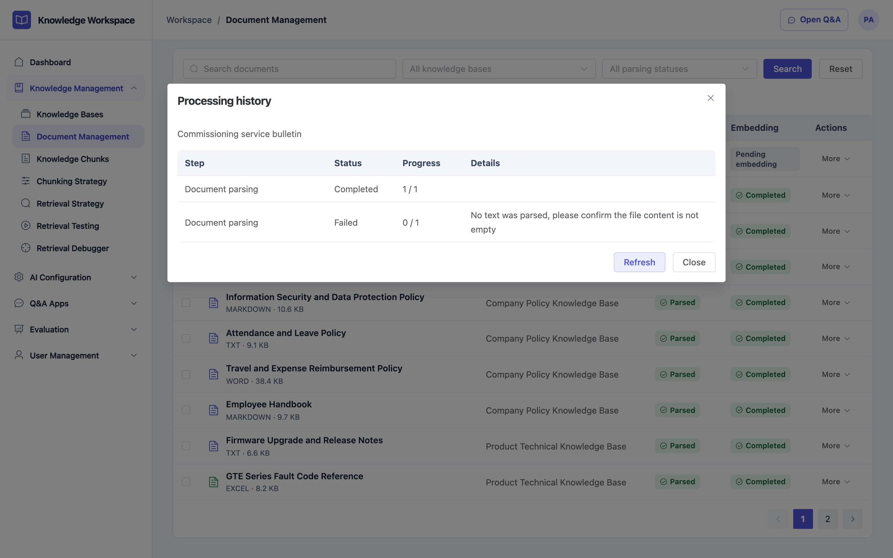</a>

</td>
</tr>
</table>

## Before: one fault code, several documents, repeated checks

A field technician is commissioning a gateway at a factory. The device reports **ERR-5022**, and the technician calls Northline's service desk for help.

The agent starts with the fault-code workbook, then opens the product manual to check the limit. The ticket says “GTE-3000,” but that is also the family name: the exact model changes the answer. The agent has to ask for clarification before giving advice. If the case changes hands, the next agent may repeat the document search because the ticket records the answer without its supporting passage.

After-sales enquiries have the same underlying problem. A distributor asks for a replacement adapter “under warranty,” but the date and policy basis are missing. Finding the policy is only part of the work; the agent must also establish whether it applies.

**The operating challenge was finding applicable guidance and preserving the evidence behind each response.** These situations come from the simulated [customer-background memo](Technical%20Support%20and%20Warranty%20Background.docx).

## The change: put the question, guidance, and evidence together

I built the workspace around that support workflow on an existing FastAPI/Vue RAG codebase. I reconstructed **11 source documents across three knowledge bases**, integrated local Ollama models, and built a clearer workspace for finding and inspecting information.

Getting an answer was only the first checkpoint. During verification, I found that replacing a document could leave its old search data behind, and a backend interruption could leave a task appearing to run forever. Those defects matter to a service desk: an agent could receive outdated guidance, or a knowledge administrator could be unable to tell whether new material was ready.

I fixed the document lifecycle, built guards against conflicting jobs, implemented interrupted-stage cleanup and retry, and built a reproducible local installation. I then compared retrieval approaches and checked their failures instead of treating a fluent answer as proof of correctness.

## Now: an agent can find an answer and inspect its basis

The technician confirms the exact model: **GTE-3000Pro**. The support agent asks:

> For ERR-5022, what is the maximum number of data points for the GTE-3000Pro?

The recorded demo returns **20,000 data points** and exposes the retrieved source passages. The agent can check the fault-code entry before advising the technician, then record the applicable passage in the existing ticket process.

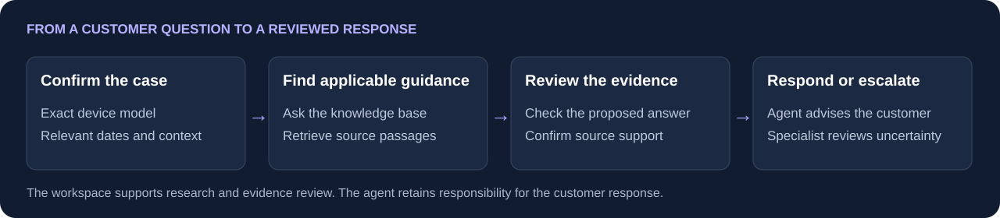

| Before: the documented support problem | Now: what the local demo supports |
| --- | --- |
| Search separate manuals, workbooks, and policies. | Ask a selected knowledge base and inspect the retrieved passages in one workspace. |
| Repeat document research when an answer has no recorded basis. | Inspect evidence that the agent can carry into ticket notes; ticket entry remains manual. |
| An uploaded replacement could leave obsolete information searchable. | Reprocessing invalidates the affected old text, chunks, and vectors. |
| An interrupted job could remain marked “Processing.” | Restart cleanup marks the attempt failed and allows a new retry while preserving history. |
| An answer sounds plausible, but its quality is unclear. | Review the evidence and compare performance against a recorded development question set. |

**An important finding remains:** the live answer gives the correct limit but names Source 2, while the explicit limit is in Source 1. That citation error is retained in the demo. I built the workspace to support the agent's judgment, not replace it: it does not remove the need for review, supply missing case details, approve warranty claims, or integrate with a ticketing system.

<details>
<summary><strong>See the citation mismatch captured in the demo</strong></summary>

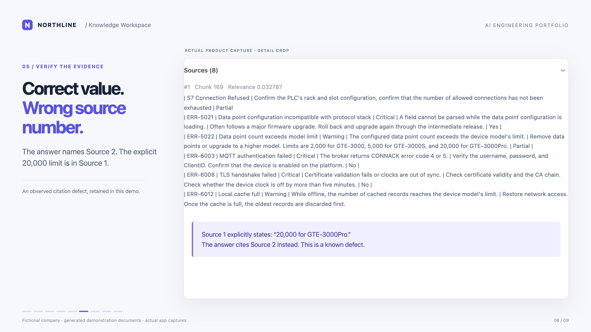

Some other phrasings also confuse recommended deployment sizes with maximum limits. Citation support and exact-model applicability remain priorities before a customer-facing pilot.

</details>

## The business case: what improvement could be worth

The intended outcomes are **less time spent finding guidance, fewer repeated checks after handoff, and more traceable customer responses**. These outcomes have not been measured with an operating support team.

The following is an **illustrative planning scenario**, not an achieved result or a claim about Northline's actual operations:

| Planning input | Assumption |
| --- | ---: |
| Support cases per week | 200 |
| Cases suitable for workspace-based research | 60% = 120 cases |
| Current lookup effort per eligible case | 10 minutes, assumed baseline |
| Lookup effort after adoption | 4 minutes, assumed target |
| Potential capacity released | **120 × (10 − 4) = 720 minutes = 12 agent-hours/week** |

Under those assumptions, lookup effort falls by **60%**. This is a scenario calculation, not a measured reduction in total resolution time. It includes the target time for source review and assumes the same answer quality. Released hours would represent service capacity, not automatically cash savings.

A real pilot would first measure the baseline, then compare similar cases with and without the workspace:

| Business metric | How it would be measured | Current status |
| --- | --- | --- |
| Verified-guidance lookup time | Time from receiving a complete question to locating and checking an applicable source. | Not measured; validate the illustrative 10 → 4 minute scenario. |
| Repeated research after handoff | Share of transferred cases requiring the receiving agent to repeat document research. | Baseline and target to be established. |
| Evidence recorded with the response | Share of audited responses with a correct, applicable source passage in the ticket notes. | Not measured; citation review must be included. |
| Incorrect or inapplicable advice | Specialist review of answers against the exact model, firmware, or policy conditions. | Development defects are known; operational quality has not been established. |

**The adoption decision would depend on time saved without an increase in incorrect advice.** These are proposed pilot measures, not existing dashboard features.

## What I built

I built the workspace around this support workflow and concentrated on the conditions that make a knowledge service useful in daily operations.

| Business need | What I built | Evidence |
| --- | --- | --- |
| A usable reference collection | Rebuilt 11 documents covering technical support, after-sales service, and company policy across five file formats. | [Raw source documents](docs/media/raw-documents.zip) |
| Answers that can be checked | Built local question answering, retrieval inspection, and expandable source passages. | [Recorded demo](docs/media/northline-demo.mp4) |
| Updated documents must replace old guidance in search | Fixed document replacement, reparsing, chunk editing, and deletion so they remove obsolete derived data. | [Lifecycle verification](evaluations/results/REPORT.md) |
| Processing failures must be understandable and recoverable | Built visible failure history, cleanup of interrupted work, and explicit retries, with guards against concurrent jobs. | [Recovery evidence](docs/verification/recovery.json) |
| Administrative source material needs controlled access | Implemented restricted administrative/raw-document access, immutable upload keys, hashed passwords, and session invalidation. | [Security and lifecycle tests](ai_rag/fastapi-app/tests/test_security_lifecycle.py) |
| Another reviewer must be able to run the project | Built Docker packaging, database seeds, local model checks, setup instructions, and verification scripts. | [Local setup guide](docs/LOCAL_SETUP.md) |

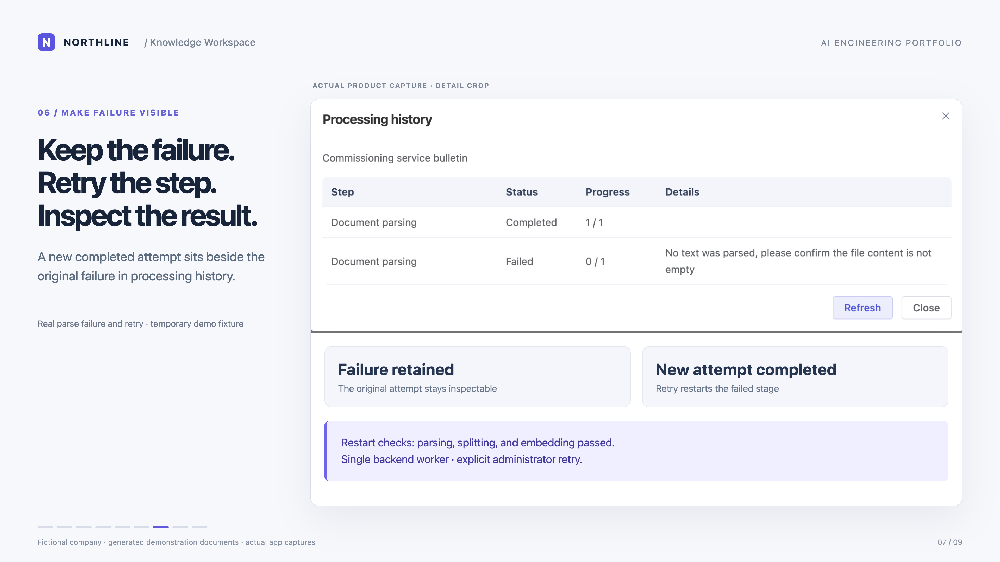

*This capture shows an actual empty-file parsing failure and a successful retry with a corrected temporary source. Separate restart tests interrupted parsing, splitting, and embedding, then verified cleanup and retry.*

## What the evidence shows

The engineering verification I ran includes **222 passing backend tests**, **three successful interrupted-stage recovery scenarios**, a clean-source installation, and desktop/mobile retry checks. These establish local functionality and selected reliability behaviors; they do not establish business impact.

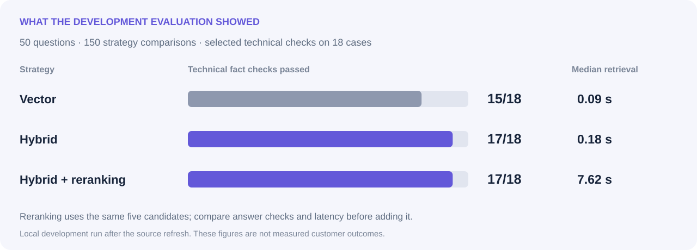

In the **50-question development evaluation I built for the refreshed corpus**, vector search passed 15 of 18 selected technical fact checks, hybrid retrieval passed 17, and hybrid with reranking passed 17. Median retrieval times were 0.09, 0.18, and 7.62 seconds, respectively.

The recorded video and screenshots use the [earlier run’s measurements](evaluations/recorded-demo/summary.json). The chart and report here describe the refreshed corpus.

**Business implication:** more processing does not automatically produce more useful support guidance. The evaluation helps decide which complexity is worth investigating, while the citation defect shows why answer review remains necessary.

The experiment contains **150 recorded comparisons**. It used a fixed five-candidate pool, provisional labels, and post-hoc fact checks; the model used to judge answers also made mistakes. See the [full evaluation report](evaluations/results/REPORT.md) and [verification record](docs/verification/README.md) for the evidence and limitations.

## What needs to happen before a business pilot

Fix the known citation and model-limit errors, test independently written questions with domain reviewers, and establish the support team's baseline metrics. Prepare shared-hosting controls before inviting users beyond the local demonstration. Only then compare actual task time, evidence quality, and handoff effort against the existing process.

## Technical implementation

The application uses **Python, FastAPI, Vue, MySQL, PostgreSQL/pgvector, Ollama, and Docker**. The demo corpus contains 110 searchable chunks/vectors and 11 additional parent chunks. Inference runs through Ollama on the local host.

<details>
<summary><strong>View the architecture and engineering decisions</strong></summary>

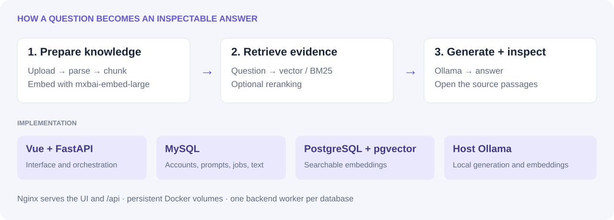

MySQL stores structured application data, prompts, and processing tasks; PostgreSQL stores embeddings. Docker volumes retain data and uploads. The deployment supports one backend worker per database and explicit failed-stage retries.

[Architecture](docs/ARCHITECTURE.md) · [Local setup](docs/LOCAL_SETUP.md) · [Verification](docs/verification/README.md)

Future engineering work includes citation validation, held-out evaluation, cleanup of unreferenced uploads, and a durable worker queue if multiple workers or automatic resumption become necessary. Shared hosting also requires deployment-specific TLS, rate limiting, monitoring, and operational controls.

</details>

## Try the workspace

For a **fresh configuration**, with Docker Compose, Python 3, and Ollama running:

```sh
ollama pull llama3.1:8b
ollama pull mxbai-embed-large:latest
python3 scripts/configure.py
python3 scripts/check_models.py
docker compose up --build -d --wait
python3 scripts/smoke.py --models
```

Open **http://127.0.0.1:8080** and sign in with **admin / admin** (public local demo credentials). The setup script preserves an existing `.env`; the prepared Desktop copy uses **8088**, so use `python3 scripts/smoke.py --url http://127.0.0.1:8088 --models` there.

Start with **Open Q&A → Product Technical Assistant**, ask the ERR-5022 question above, and inspect **Sources**. To explore administration, upload a practice document, parse it, split it into chunks, embed it, and review **Processing history**.

The verified environment is Apple Silicon with Docker Desktop and host Ollama. [Full setup and troubleshooting](docs/LOCAL_SETUP.md) · [Manual setup](Database%20Setup.md) · [Evaluation reproduction](evaluations/README.md)
