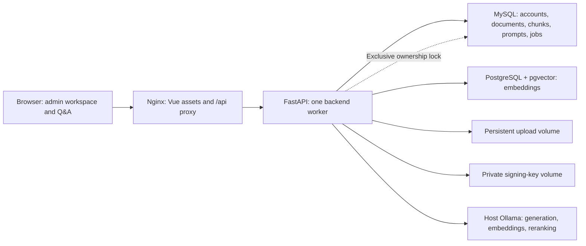
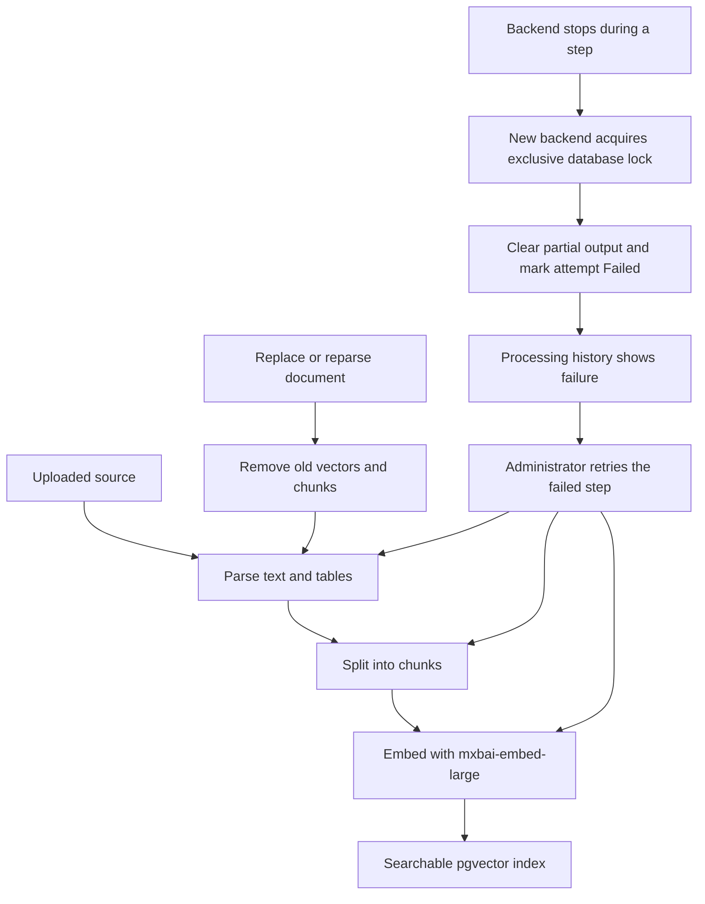
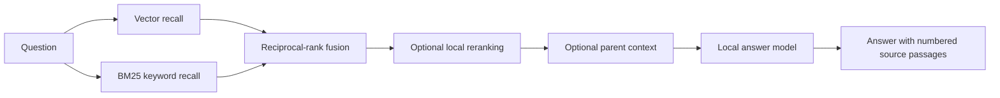

# Architecture

Northline is a fictional industrial-support scenario built on an existing Vue/FastAPI RAG application. The local deployment keeps inference on the host's Ollama service and uses containers for the web application and databases.

## Runtime

Only the frontend port is published, bound to the loopback address. MySQL, PostgreSQL, and the backend are reachable inside the Compose network. The frontend uses a relative /api endpoint, so browser hostnames and API URLs do not need separate builds.

New uploads have unique storage keys. Database records retain the display filename separately. The backend translates legacy seed download URLs into the configured public API path; parsing resolves the storage key locally rather than fetching a URL.

## Document lifecycle

MySQL and PostgreSQL do not share a distributed transaction. Cleanup is ordered so a failure prevents the app from declaring recovery complete. If PostgreSQL is unavailable during recovery, startup fails and the next startup retries cleanup. Deleting already-deleted vector rows is safe.

Each processing request commits a task record before its background work starts. On restart, the backend recovers Processing tasks only after acquiring the MySQL ownership lock. Parsing recovery clears parsed text and derived data; splitting recovery retains parsed text but discards partial chunks; embedding recovery retains chunks but discards partial vectors.

Retry creates a new task and preserves the failed attempt. New splitting jobs store their strategy snapshot; retry uses that snapshot. Older jobs without a snapshot require the administrator to choose a strategy through Split into chunks. Embedding retries retain the knowledge base's model binding and reject incompatible active models.

This is a single-worker local deployment with explicit retry, not a distributed queue. A dedicated MySQL connection holds the ownership lock and checks it every 20 seconds. When that check detects lost ownership, it terminates the backend. This guard prevents ordinary concurrent startup; it is not a distributed fencing protocol for network partitions.

## Retrieval and generation

The inherited application also supports configurable prompts, query rewriting, agents/tools, conversation history, feedback, and evaluation management. The portfolio benchmark isolates vector, hybrid, and hybrid-plus-reranking paths; it does not establish the correctness of every agent/tool workflow.

## Boundaries and remaining work

- Accounts have administrator and standard-user roles. Raw documents/chunks and user directories require administrator access; standard users use Q&A and their own profiles.
- The local demo credentials are public examples. The deployment is not an Internet-facing production configuration.
- Failed-stage retry is implemented. Automatic queue resumption, horizontal workers, and scheduling are future work.
- Answer quality still needs improvement: some questions confuse recommended deployment sizes with hard model limits. The evaluation report preserves this failure.
